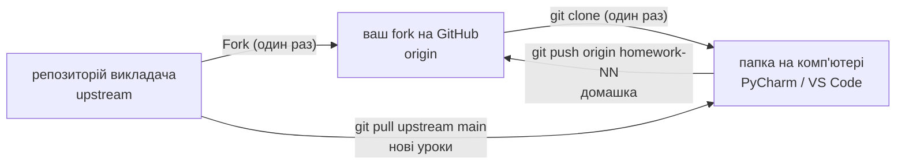

# 🐍 Python Programming — Viktor Nikoriak

Курс Python українською, від основ до просунутих тем — у форматі: **ноутбуки занять** + **книга теорії**.

Цей репозиторій містить:

- ✅ матеріали занять (ноутбуки, по модулях)
- ✅ практичні завдання й домашні роботи
- ✅ workflow роботи через GitHub (як у реальній IT-команді)

## 📖 Книга курсу

Повна теорія, довідники та інструкції — у [книзі курсу на GitHub Pages](https://nikoriakviktor.github.io/PY-Course-Victor-Nikoriak-11-11-2026/).

[Вихідні файли книги](docs/index.md)

Швидкі посилання:

- [**Швидкий старт** — усе налаштування по кроках](docs/00_getting_started/quick_start.md) ([у книзі](https://nikoriakviktor.github.io/PY-Course-Victor-Nikoriak-11-11-2026/00_getting_started/quick_start/))
- [Як користуватися курсом](docs/00_getting_started/README.md)
- [Ноутбуки в Google Colab](docs/00_getting_started/colab.md)
- [SSH-ключі для GitHub](docs/00_getting_started/github/ssh_keys.md)
- [Профіль GitHub: README-візитівка](docs/00_getting_started/github/profile_readme.md) ([у книзі](https://nikoriakviktor.github.io/PY-Course-Victor-Nikoriak-11-11-2026/00_getting_started/github/profile_readme/))
- [Здача домашніх робіт](docs/00_getting_started/homework_workflow.md)
- [Часті проблеми і нюанси](docs/00_getting_started/troubleshooting.md) ([у книзі](https://nikoriakviktor.github.io/PY-Course-Victor-Nikoriak-11-11-2026/00_getting_started/troubleshooting/))

## 🚀 Швидкий старт

Нижче — повний шлях від «нічого не встановлено» до «урок відкрито, домашку можна здати». Та сама інструкція з вкладками для кожної системи — у книзі: **[Швидкий старт](https://nikoriakviktor.github.io/PY-Course-Victor-Nikoriak-11-11-2026/00_getting_started/quick_start/)**. Якщо на якомусь кроці з'явилась помилка — **[Часті проблеми і нюанси](docs/00_getting_started/troubleshooting.md)**.

> 💡 **Хочете спробувати Python просто зараз, нічого не встановлюючи?** Відкрийте ноутбук-пісочницю в браузері:
>
> [](https://colab.research.google.com/github/NikoriakViktor/PY-Course-Victor-Nikoriak-11-11-2026/blob/main/module_1/lessons/lesson_01_intro_and_course_format/hello_course.ipynb) — [`hello_course.ipynb`](module_1/lessons/lesson_01_intro_and_course_format/hello_course.ipynb)
>
> У ньому — що таке ноутбук і Google Colab, перший `print("Hello, курс Python у Beetroot Academy!")` і перша задача. Потрібен лише Google-акаунт. Одразу зробіть **File → Save a copy in Drive**. Докладно: [Ноутбуки в Google Colab](docs/00_getting_started/colab.md).

### Як усе влаштовано



- **upstream** — репозиторій викладача. Звідти ви лише **забираєте** нові уроки.
- **origin** — ваш fork. Туди ви **надсилаєте** домашні роботи.
- **папка на комп'ютері** — клон вашого fork. У ній ви працюєте.

---

### 0. Зареєструйтесь на GitHub

Якщо акаунт уже є — переходьте до кроку 1.

1. Відкрийте [github.com/signup](https://github.com/signup).
2. Вкажіть **email**, **пароль** і **username** (логін — лише латинські літери, цифри й дефіс).
3. Введіть код підтвердження з листа.
4. Якщо GitHub пропонує тариф — оберіть **Free**.

> ⚠️ **Оберіть нормальний логін одразу.** Логін стане частиною адреси профілю й кожного вашого репозиторію: `github.com/<ваш-логін>/…`. Ці посилання ви даватимете викладачу, а згодом вставите в резюме.
>
> ✅ `olena-kovalenko`, `okovalenko` — ❌ `zaya12`, `xX_kotik2009_Xx`
>
> Змінити логін пізніше можна, але посилання зі старим логіном, які ви вже залишили на сторонніх ресурсах, можуть перестати працювати й показувати помилку.
>
> Реальний приклад: після зміни логіна `NikoriakViktot` → `NikoriakViktor` (одна літера!) адреса `nikoriakviktot.github.io/notes_chat_app/` показує **404 — There isn't a GitHub Pages site here**, хоча сам сайт працює за новою адресою `nikoriakviktor.github.io/notes_chat_app/`.

Оформіть сторінку профілю — фото, ім'я, README-візитівку: [Профіль GitHub: README-візитівка](docs/00_getting_started/github/profile_readme.md).

Докладно: [Швидкий старт → Реєстрація на GitHub](https://nikoriakviktor.github.io/PY-Course-Victor-Nikoriak-11-11-2026/00_getting_started/quick_start/#github-signup)

---

### 1. Встановіть Git

<details>
<summary><b>🪟 Windows</b></summary>

Завантажте інсталятор з [git-scm.com/install/windows](https://git-scm.com/install/windows) і встановіть, натискаючи **Next**. Або в PowerShell:

```powershell
winget install --id Git.Git -e
```

Після встановлення **закрийте й знову відкрийте PowerShell**.

</details>

<details>
<summary><b>🍎 macOS</b></summary>

```bash
xcode-select --install
```

У вікні, що з'явиться, натисніть **Install**. Інші способи: [git-scm.com/install/mac](https://git-scm.com/install/mac).

</details>

<details>
<summary><b>🐧 Linux</b></summary>

```bash
# Ubuntu / Debian
sudo apt update
sudo apt install git

# Fedora
sudo dnf install git
```

Інші дистрибутиви: [git-scm.com/install/linux](https://git-scm.com/install/linux).

</details>

Перевірте:

```bash
git --version
```

Представтесь Git (один раз на комп'ютер; email — той самий, що на GitHub):

```bash
git config --global user.name "Імʼя Прізвище"
git config --global user.email "ваш_email_на_GitHub"
```

Докладно: [Встановлення Git](docs/00_getting_started/git_setup.md)

---

### 2. Встановіть Python 3.10+

<details>
<summary><b>🪟 Windows</b></summary>

1. Завантажте Python з [python.org/downloads](https://www.python.org/downloads/).
2. Якщо на першому екрані інсталятора є галочка **Add python.exe to PATH** — **обов'язково поставте її**.
3. Закрийте й знову відкрийте PowerShell.

```powershell
python --version
```

Якщо `python` не знайдено — спробуйте `py --version` і розділ [«Python не знайдено»](https://nikoriakviktor.github.io/PY-Course-Victor-Nikoriak-11-11-2026/00_getting_started/troubleshooting/#python-not-found).

</details>

<details>
<summary><b>🍎 macOS</b></summary>

Інсталятор з [python.org/downloads](https://www.python.org/downloads/) або `brew install python`. Команда на macOS називається `python3`:

```bash
python3 --version
```

</details>

<details>
<summary><b>🐧 Linux</b></summary>

```bash
# Ubuntu / Debian
sudo apt install python3 python3-venv python3-pip
```

```bash
python3 --version
```

</details>

---

### 3. Підключіть SSH-ключ до GitHub

SSH-ключ дає змогу виконувати `git clone`, `git pull` і `git push` без пароля. Створюється один раз на комп'ютер.

```bash
ssh-keygen -t ed25519 -C "ваш_email_на_GitHub"
```

На всі запитання натискайте **Enter**. Потім скопіюйте **публічний** ключ:

| Система | Команда |
|---|---|
| Windows (PowerShell) | `Get-Content "$env:USERPROFILE\.ssh\id_ed25519.pub" \| Set-Clipboard` |
| macOS | `pbcopy < ~/.ssh/id_ed25519.pub` |
| Linux | `cat ~/.ssh/id_ed25519.pub` — і скопіюйте рядок вручну |

Додайте його на сторінці [github.com/settings/keys](https://github.com/settings/keys) → **New SSH key**.

Перевірте:

```bash
ssh -T git@github.com
```

Правильна відповідь: `Hi <ваш-логін>! You've successfully authenticated…`

Докладно, з розбором помилок: [SSH-ключі для GitHub](docs/00_getting_started/github/ssh_keys.md)

---

### 4. Зробіть Fork репозиторію

**Що таке fork.** Репозиторій курсу належить викладачу: читати його може кожен, а змінювати — лише він. **Fork** — це ваша особиста копія цього репозиторію на GitHub. У ній ви власник: створюєте гілки, робите commit-и, надсилаєте домашні роботи. Аналогія: викладач роздав усім однаковий робочий зошит — оригінал лишається в нього, а ви пишете у своєму примірнику.

| | Fork | Clone | Branch |
|---|---|---|---|
| Що це | копія **на GitHub** у вашому акаунті | копія **на комп'ютері** | окрема лінія змін усередині репозиторію |
| Коли | один раз | один раз | для кожної домашки |

**Як створити:**

1. Увійдіть у GitHub і відкрийте сторінку створення fork: [https://github.com/NikoriakViktor/PY-Course-Victor-Nikoriak-11-11-2026/fork](https://github.com/NikoriakViktor/PY-Course-Victor-Nikoriak-11-11-2026/fork) (або кнопка **Fork** угорі праворуч на сторінці цього репозиторію).
2. **Owner** → **Choose an owner** → оберіть **свій акаунт**.
3. **Repository name** не змінюйте.
4. Галочка **Copy the `main` branch only** — увімкнена.
5. Натисніть **Create fork**.

Перевірте: відкрилася сторінка `https://github.com/<ваш-логін>/PY-Course-Victor-Nikoriak-11-11-2026`, під назвою є рядок `forked from NikoriakViktor/…`.

Працюйте у **власному fork**, а не безпосередньо в репозиторії викладача.

Детально: [Fork, SSH і Clone](docs/00_getting_started/github/fork_and_clone.md) · [Що таке fork і навіщо він](https://nikoriakviktor.github.io/PY-Course-Victor-Nikoriak-11-11-2026/00_getting_started/quick_start/#fork)

---

### 5. Клонуйте свій Fork

> 🪟 **Windows:** клонуйте в коротку папку без кирилиці та пробілів, наприклад `C:\Projects`. Не в OneDrive.

```bash
git clone git@github.com:<your-username>/PY-Course-Victor-Nikoriak-11-11-2026.git
cd PY-Course-Victor-Nikoriak-11-11-2026
```

`<your-username>` замініть на свій логін — без кутових дужок.

Додайте репозиторій викладача як `upstream`:

```bash
git remote add upstream https://github.com/NikoriakViktor/PY-Course-Victor-Nikoriak-11-11-2026.git
```

Перевірте:

```bash
git remote -v
```

Має бути:

```text
origin    → ваш Fork
upstream  → репозиторій курсу
```

---

### 6. Створіть віртуальне середовище

У папці репозиторію:

<details>
<summary><b>🪟 Windows (PowerShell)</b></summary>

```powershell
python -m venv .venv
.venv\Scripts\activate
```

Якщо PowerShell відповів «виконання сценаріїв вимкнено» — виконайте один раз `Set-ExecutionPolicy RemoteSigned -Scope CurrentUser` і повторіть активацію.

</details>

<details>
<summary><b>🍎 macOS / 🐧 Linux</b></summary>

```bash
python3 -m venv .venv
source .venv/bin/activate
```

</details>

На початку рядка термінала має з'явитися `(.venv)`. Тепер встановіть бібліотеки:

```bash
python -m pip install --upgrade pip
pip install jupyterlab notebook ipykernel
pip install -r requirements.txt
```

Другий рядок — мінімум для модуля 1; третій ставить усі бібліотеки курсу й триває кілька хвилин. Якщо якийсь пакет не встановився — [«Не встановлюються бібліотеки»](https://nikoriakviktor.github.io/PY-Course-Victor-Nikoriak-11-11-2026/00_getting_started/troubleshooting/#pip-install-fails).

👉 [Налаштування Python-середовища](docs/00_getting_started/environment_setup.md)

---

### 7. Відкрийте проєкт у PyCharm або VS Code

Оберіть **один** редактор — для курсу підходять обидва.

<details>
<summary><b>PyCharm</b></summary>

1. Встановіть PyCharm: [jetbrains.com/pycharm/download](https://www.jetbrains.com/pycharm/download/).
2. **Open** → папка `PY-Course-Victor-Nikoriak-11-11-2026`.
3. Клік по назві інтерпретатора в правому нижньому куті → **Add New Interpreter → Add Local Interpreter** → наявне середовище → `.venv\Scripts\python.exe` (Windows) або `.venv/bin/python` (macOS/Linux).
4. Термінал: **Alt+F12** — рядок має починатися з `(.venv)`.

Повний гайд: [PyCharm](docs/00_getting_started/pycharm.md)

</details>

<details>
<summary><b>VS Code</b></summary>

1. Встановіть VS Code: [code.visualstudio.com](https://code.visualstudio.com/).
2. **File → Open Folder…** → папка `PY-Course-Victor-Nikoriak-11-11-2026`.
3. Розширення (**Ctrl+Shift+X**): **Python** і **Jupyter** від Microsoft.
4. **Ctrl+Shift+P → Python: Select Interpreter** → рядок зі шляхом `.venv`.
5. У ноутбуці: **Select Kernel** угорі праворуч → `.venv`.

Повний гайд: [VS Code](docs/00_getting_started/vscode.md)

</details>

Після цього відкрийте потрібний урок у:

```text
module_1/lessons/lesson_NN_<тема>/    ← NN = номер уроку за програмою курсу
```

Для занять відкривайте файл із закінченням `_student.ipynb` — у ньому вправи без розв'язків.

#### Перший ноутбук у JupyterLab

У терміналі в папці репозиторію, з активованим `(.venv)`:

```bash
jupyter lab
```

Браузер відкриється сам. У панелі ліворуч відкрийте `module_1/lessons/lesson_01_intro_and_course_format/hello_course.ipynb` — ту саму пісочницю, що й у Colab, — і виконуйте клітинки **Shift+Enter**. Термінал не закривайте, поки працюєте; зупинити сервер — **Ctrl+C**.

Що таке Colab і JupyterLab, чим вони відрізняються і як працювати в кожному: [Швидкий старт → Перший ноутбук](https://nikoriakviktor.github.io/PY-Course-Victor-Nikoriak-11-11-2026/00_getting_started/quick_start/#first-notebook) · [Jupyter локально](docs/00_getting_started/jupyter.md) · [Google Colab](docs/00_getting_started/colab.md)

---

### 8. Перед кожним заняттям оновлюйте `main`

```bash
git checkout main
```
```bash
git pull upstream main
```

```bash
git push origin main
```

```bash
git checkout main
git pull upstream main
git push origin main
```


Так ви отримаєте нові матеріали курсу.

---

### 9. Домашні роботи виконуйте в окремій гілці

```bash
git checkout -b homework-01
```

```bash
# після виконання завдання
git add .
```
```bash
git commit -m "Homework 01"
```
```bash
git push origin homework-01
```

```bash
git checkout -b homework-01

# після виконання завдання
git add .
git commit -m "Homework 01"
git push origin homework-01
```


Після цього на GitHub створіть **Pull Request**:

```text
homework-01 → main
```

**Pull Request = здача домашнього завдання.**

👉 [Детальна інструкція зі здачі домашніх робіт](docs/00_getting_started/homework_workflow.md)

> ⚠️ **Не виконуйте домашні роботи у `main`.**
> Одна домашня робота = одна окрема гілка.

Якщо щось не працює: [Часті проблеми і нюанси](docs/00_getting_started/troubleshooting.md) — помилки Git, Python, venv, GitHub, PyCharm і VS Code з рішеннями.


## Про курс і викладача

- [Архітектура репозиторію](architecture.md)
- [Про викладача](instructor.md)
- [Сертифікати](certificates/beetroot_python_2021.md)
