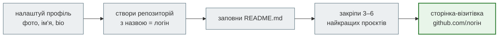

# Профіль GitHub: README-візитівка

Твоя сторінка `https://github.com/<твій-логін>` — це **обличчя розробника**. Її відкривають рекрутер, викладач, майбутній колега. Без налаштування там лише аватар і список репозиторіїв. З **README профілю** вгорі сторінки з'являється візитівка: хто ти, що вмієш, над чим працюєш, як з тобою зв'язатися.



Займає 30–40 хвилин. Робиться один раз і потім лише доповнюється.

!!! note "Спершу — нормальний логін"
    Візитівка живе за адресою `github.com/<твій-логін>`. Якщо логін на кшталт `zaya12`, спершу прочитай [Швидкий старт → Реєстрація на GitHub](../quick_start.md#github-signup) — змінити логін краще **до** того, як ти почнеш роздавати посилання.

## Крок 1. Заповни публічний профіль

Відкрий [github.com/settings/profile](https://github.com/settings/profile) (аватар → **Settings** → **Public profile**).

| Поле | Що вписати | Приклад |
|---|---|---|
| **Profile picture** | справжнє фото обличчя, нейтральний фон, без сонцезахисних окулярів | — |
| **Name** | ім'я та прізвище латиницею, як у резюме й LinkedIn | `Olena Kovalenko` |
| **Bio** | одне речення: хто ти і що робиш | `Python Developer · Data analysis & automation` |
| **Pronouns** | за бажанням | — |
| **Location** | місто, країна | `Kyiv, Ukraine` |
| **Social accounts** | LinkedIn, Telegram — до 4 посилань | `https://www.linkedin.com/in/olena-kovalenko` |

Натисни **Update profile** унизу сторінки.

!!! warning "Що не варто публікувати"
    Номер телефону, домашню адресу, дату народження. Email — лише якщо готовий отримувати на нього листи від незнайомців (і спам). Для профілю краще окрема робоча пошта.

## Крок 2. Створи спеціальний репозиторій

Візитівку показує **спеціальний репозиторій**, назва якого **точно збігається з твоїм логіном**.

1. Відкрий [github.com/new](https://github.com/new).
2. **Owner** — твій акаунт.
3. **Repository name** — твій логін, літера в літеру. Якщо логін `olena-kovalenko`, репозиторій — теж `olena-kovalenko`.

    Коли назва правильна, GitHub сам підтвердить це повідомленням:

    ```text
    ✨ olena-kovalenko/olena-kovalenko is a ✨special✨ repository.
    Its README.md will appear on your public profile.
    ```

    Немає цього повідомлення — назва не збігається з логіном. Перевір дефіси й літери.

4. **Description** — можна залишити порожнім.
5. **Public** — обов'язково. Приватний репозиторій на профілі не показується.
6. Постав галочку **Add a README file**.
7. Натисни **Create repository**.

**Перевір:** відкрий `https://github.com/<твій-логін>` — угорі сторінки з'явився блок `<твій-логін> / README.md` з текстом-заготовкою від GitHub.

## Крок 3. Заповни README.md

README пишеться мовою **Markdown** — тією самою, що й текстові клітинки ноутбуків. Відредагувати файл можна двома способами.

=== "Просто в браузері"

    1. Відкрий репозиторій `<твій-логін>/<твій-логін>`.
    2. Клацни файл `README.md` → значок олівця **Edit this file** угорі праворуч.
    3. Видали заготовку й встав шаблон нижче.
    4. Вкладка **Preview** показує, як це виглядатиме.
    5. **Commit changes…** → повідомлення `Add profile README` → **Commit changes**.

=== "Через Git і редактор"

    ```bash
    cd C:\Projects        # або ~/projects
    git clone git@github.com:<твій-логін>/<твій-логін>.git
    cd <твій-логін>
    ```

    Відкрий папку в PyCharm чи VS Code, відредагуй `README.md` (у PyCharm є попередній перегляд Markdown праворуч), потім:

    ```bash
    git add README.md
    git commit -m "Add profile README"
    git push
    ```

### Шаблон

Скопіюй і заміни всі дані на свої. Розділи, яких у тебе ще немає, просто видали.

````markdown
<h1 align="center">Olena Kovalenko</h1>

<h3 align="center">Python Developer · Data Analysis & Automation</h3>

<p align="center">
📍 Kyiv, Ukraine<br>
🎓 Python course at Beetroot Academy<br>
💻 Python • SQL • Git • Data analysis
</p>

<p align="center">
  <a href="https://www.linkedin.com/in/olena-kovalenko">
    
  </a>
  <a href="https://t.me/olena_kovalenko">
    
  </a>
</p>

---

## 👩‍💻 About Me

I'm learning Python development and building small projects to practice:
data analysis with pandas, automation scripts and simple web services.

I enjoy turning messy data into clear answers and repetitive tasks into scripts.

## 🛠 Tech Stack


## 🚀 Projects

| Project | What it does | Stack |
|---|---|---|
| [weather-cli](https://github.com/olena-kovalenko/weather-cli) | Weather forecast in the terminal | Python, requests |
| [cafe-orders](https://github.com/olena-kovalenko/cafe-orders) | Order analysis for a cafe | Python, pandas |

## 📫 Contact

Open to internships and junior positions — write me on LinkedIn or Telegram.
````

### Як працюють значки (badges)

Кольорові плашки — це картинки сервісу [shields.io](https://shields.io/badges/static-badge). Текст і колір задаються прямо в адресі:

```text
https://img.shields.io/badge/<ліва частина>-<права частина>-<колір>?style=for-the-badge&logo=<логотип>
```

| У тексті значка | Як записати в адресі |
|---|---|
| пробіл | `_` або `%20` |
| дефіс `-` | `--` |
| підкреслення `_` | `__` |

Назви логотипів (`python`, `django`, `docker`, `postgresql`, `linux`, `telegram`, `linkedin`…) — з каталогу [simpleicons.org](https://simpleicons.org/). Значок технології з одного слова: `https://img.shields.io/badge/Docker-2496ED?style=for-the-badge&logo=docker&logoColor=white`.

### Що писати, а чого не варто

| Добре | Погано |
|---|---|
| 2–3 речення про те, що ти робиш **зараз** і чого хочеш | «Я дуже люблю програмування з дитинства!!!» на пів екрана |
| у Tech Stack — те, чим ти справді користувався в проєктах | 30 значків технологій, яких ти ще не торкався |
| 2–4 реальні проєкти з посиланнями й одним реченням опису | жодного посилання або посилання на порожні репозиторії |
| англійською — її читають рекрутери з будь-якої країни | суміш мов у кожному реченні |
| оновлюєш, коли з'являється новий проєкт | заготовка `Hi there 👋` від GitHub, яку ніхто не змінив |

!!! tip "Коли ще нема чим хвалитися"
    Це нормально на старті курсу. Почни з імені, одного речення про себе, контактів і Tech Stack із `Python` і `Git`. Розділ Projects додаси, щойно з'явиться перший власний проєкт — наприклад, фінальний проєкт модуля 1.

## Крок 4. Закріпи найкращі проєкти

Під README на сторінці профілю є блок **Pinned** — до 6 репозиторіїв, які всі бачать першими.

1. На своїй сторінці профілю знайди блок **Popular repositories** → **Customize your pins**.
2. Відміть 3–6 найкращих власних проєктів.
3. **Save pins**.

Закріплюй те, що не соромно показати: з описом, README і робочим кодом. Fork курсу закріплювати не треба — у ньому код викладача. Як зробити власний репозиторій для проєкту: [Як створити свій репозиторій](create_repository.md).

## Перевір себе

Відкрий `https://github.com/<твій-логін>` у вікні браузера **інкогніто** — так тебе бачать інші:

- [ ] фото обличчя й ім'я латиницею;
- [ ] Bio в одне речення, місто;
- [ ] README-візитівка вгорі сторінки, без тексту-заготовки GitHub;
- [ ] усі значки й посилання відкриваються;
- [ ] закріплено проєкти з описом.

## Якщо README не з'являється на профілі

| Причина | Що зробити |
|---|---|
| назва репозиторію не збігається з логіном | **Settings** репозиторію → **Repository name** → впиши логін точно, без пробілів і зайвих символів |
| репозиторій приватний | **Settings** репозиторію → унизу **Danger Zone → Change visibility → Make public** |
| файл називається інакше або лежить у папці | має бути саме `README.md` у **корені** репозиторію |
| зміни не надіслано | у браузері — натисни **Commit changes**; локально — `git push` |
| значок показує `invalid` | помилка в адресі shields.io: перевір дефіси й підкреслення (таблиця вище) |

## Джерела

- GitHub Docs: [Managing your profile README](https://docs.github.com/en/account-and-profile/how-tos/profile-customization/managing-your-profile-readme), [Pinning items to your profile](https://docs.github.com/en/account-and-profile/how-tos/profile-customization/pinning-items-to-your-profile)
- [Basic writing and formatting syntax](https://docs.github.com/en/get-started/writing-on-github/getting-started-with-writing-and-formatting-on-github/basic-writing-and-formatting-syntax) — Markdown на GitHub
- [shields.io — Static badge](https://shields.io/badges/static-badge), [Simple Icons](https://simpleicons.org/) — значки й логотипи
