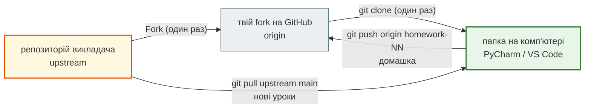

# Швидкий старт

Ця сторінка веде від «нічого не встановлено» до «ноутбук уроку відкрито, домашку можна здати». Іди згори вниз і не пропускай кроки з позначкою **Перевір** — вони показують, що попередній крок справді вдався.

Якщо на якомусь кроці з'явилась помилка — шукай її текст на сторінці [Часті проблеми і нюанси](troubleshooting.md).

## Два шляхи

| | Шлях А — Google Colab | Шлях Б — на своєму комп'ютері |
|---|---|---|
| Що потрібно | браузер і Google-акаунт | Git, Python, PyCharm або VS Code |
| Час на налаштування | 2 хвилини | 30–60 хвилин |
| Для чого | відкрити урок просто зараз | повноцінна робота й здача домашніх робіт |

**Шлях А** — щоб не пропустити перше заняття, якщо щось не встановилось. **Шлях Б** потрібен усім: домашні роботи здаються через Git і GitHub.

## Шлях А. Урок у Colab за 2 хвилини

1. Відкрий потрібний урок у [книзі курсу](../modules/README.md).
2. Натисни кнопку **Відкрити вправи в Colab** (або значок **Open in Colab** у першій клітинці ноутбука).
3. У Colab: **File → Save a copy in Drive** — без цього твої зміни не збережуться.
4. Виконуй клітинки клавішами **Shift+Enter**.

Докладно: [Ноутбуки в Google Colab](colab.md).

## Шлях Б. Повне налаштування

Ось що ти побудуєш за наступні 9 кроків:



- **upstream** — репозиторій викладача. Звідти ти лише **забираєш** нові уроки.
- **origin** — твій fork (особиста копія на GitHub). Туди ти **надсилаєш** домашні роботи.
- **локальна папка** — клон твого fork на комп'ютері. У ній ти працюєш.

### Крок 0. Що знадобиться

- Акаунт на GitHub — якщо його ще немає, зареєструйся (інструкція нижче).
- Термінал:

    | Система | Який термінал відкрити |
    |---|---|
    | Windows 10/11 | **PowerShell** (меню Пуск → введи `powershell`) |
    | macOS | **Terminal** (Spotlight **⌘ Space** → `Terminal`) |
    | Linux | **Terminal** (зазвичай **Ctrl+Alt+T**) |

#### Реєстрація на GitHub { #github-signup }

Якщо акаунт уже є — пропусти цей блок.

1. Відкрий [github.com](https://github.com/) і натисни **Sign up** угорі праворуч — або одразу перейди на [github.com/signup](https://github.com/signup).
2. Заповни форму:
    - **Email** — пошта, до якої ти маєш доступ: на неї прийде код підтвердження;
    - **Password** — надійний пароль, якого ти не використовуєш на інших сайтах;
    - **Username** — твій логін. Лише латинські літери, цифри й дефіс.
3. Пройди перевірку «я не робот», якщо GitHub її покаже.
4. Введи **код підтвердження** з листа, який прийшов на пошту.
5. Якщо GitHub пропонує обрати тариф — вибери **Free**. Опитування про досвід можна пропустити (**Skip**).

**Перевір:** відкрий `https://github.com/<твій-логін>` — має відкритися твій профіль.

!!! warning "Обери нормальний логін одразу"
    Логін — це твоє ім'я в професійному світі. Він стане частиною адреси профілю, кожного репозиторію й кожного сайту на GitHub Pages:

    ```text
    https://github.com/<твій-логін>
    https://github.com/<твій-логін>/PY-Course-Victor-Nikoriak-11-11-2026
    https://<твій-логін>.github.io/…
    ```

    Саме ці посилання ти даватимеш викладачу, одногрупникам, а згодом вставиш у резюме й LinkedIn.

    | Добре | Погано |
    |---|---|
    | `olena-kovalenko` | `zaya12` |
    | `okovalenko` | `xX_kotik2009_Xx` |
    | `kovalenko-dev` | `qwerty123456` |

    Найпростіше — ім'я та прізвище латиницею. Якщо такий логін зайнятий, додай ініціал або `-dev`.

    **Змінити логін пізніше можна** (**Settings → Account → Change username**), але всі посилання зі старим логіном, які ти вже десь залишив — у резюме, на LinkedIn, у чатах, на інших сайтах, — можуть перестати працювати й показувати помилку 404. Сайти на GitHub Pages і адреса профілю перестають відкриватися одразу.

    Реальний приклад — викладач змінив логін `NikoriakViktot` на `NikoriakViktor`, тобто лише одну літеру:

    | Адреса | Що відкривається |
    |---|---|
    | `nikoriakviktot.github.io/notes_chat_app/` — старий логін | **404** — `There isn't a GitHub Pages site here.` |
    | `nikoriakviktor.github.io/notes_chat_app/` — новий логін | сайт курсу |

    Сайт той самий і нікуди не зник, але кожне старе посилання на нього — у чатах, презентаціях, на інших сайтах — тепер показує помилку, і виправляти їх доводиться вручну.

    Тому краще один раз обрати добре. Довідка GitHub: [Username changes](https://docs.github.com/en/account-and-profile/concepts/username-changes).

!!! note "Той самий email — у Git"
    Запам'ятай, з якою поштою ти зареєструвався: її ж треба буде вказати в `git config` на кроці 1. Тоді GitHub прив'яже твої commit-и до твого профілю.

Щоб захистити акаунт, увімкни двофакторну автентифікацію: аватар → **Settings → Password and authentication → Two-factor authentication** ([github.com/settings/security](https://github.com/settings/security)). GitHub з часом сам попросить це зробити.

Довідка GitHub: [Creating an account on GitHub](https://docs.github.com/en/get-started/start-your-journey/creating-an-account-on-github).

!!! warning "Windows: де тримати проєкт"
    Клонуй репозиторій у коротку папку без кирилиці та пробілів, наприклад `C:\Projects`. Не клади його в **OneDrive**, на Робочий стіл чи в «Документи», якщо вони синхронізуються з OneDrive: синхронізація блокує файли Git і віртуального середовища.

### Крок 1. Встанови Git

=== "Windows"

    Завантаж інсталятор з [git-scm.com/install/windows](https://git-scm.com/install/windows) і встанови, натискаючи **Next** (налаштування за замовчуванням підходять).

    Або однією командою в PowerShell:

    ```powershell
    winget install --id Git.Git -e
    ```

    Після встановлення **закрий і знову відкрий PowerShell** — інакше команда `git` не знайдеться.

=== "macOS"

    ```bash
    xcode-select --install
    ```

    З'явиться вікно — натисни **Install**. Це встановлює інструменти розробника Apple, серед яких є Git. Інші способи: [git-scm.com/install/mac](https://git-scm.com/install/mac).

=== "Linux"

    ```bash
    # Ubuntu / Debian
    sudo apt update
    sudo apt install git

    # Fedora
    sudo dnf install git

    # Arch
    sudo pacman -S git
    ```

    Інші дистрибутиви: [git-scm.com/install/linux](https://git-scm.com/install/linux).

**Перевір:**

```bash
git --version
```

```text
git version 2.47.1
```

Номер версії в тебе може бути іншим — головне, що команда відповіла.

Тепер представся Git (один раз на комп'ютер). Ці дані потраплять у кожен твій commit:

```bash
git config --global user.name "Імʼя Прізвище"
git config --global user.email "твій_email_на_GitHub"
```

**Перевір:**

```bash
git config --global user.name
git config --global user.email
```

Докладно: [Встановлення Git](git_setup.md).

### Крок 2. Встанови Python

Потрібен **Python 3.10 або новіший**.

=== "Windows"

    1. Завантаж Python з [python.org/downloads](https://www.python.org/downloads/).
    2. Запусти інсталятор. Якщо на першому екрані є галочка **Add python.exe to PATH** — **обов'язково постав її**, потім **Install Now**.
    3. Закрий і знову відкрий PowerShell.

    **Перевір:**

    ```powershell
    python --version
    ```

    Якщо `python` не знайдено або відкрився Microsoft Store — спробуй `py --version` і подивись розділ [«Python не знайдено»](troubleshooting.md#python-not-found).

=== "macOS"

    Завантаж інсталятор з [python.org/downloads](https://www.python.org/downloads/) і встанови. Якщо користуєшся Homebrew:

    ```bash
    brew install python
    ```

    **Перевір** (на macOS команда називається `python3`):

    ```bash
    python3 --version
    ```

=== "Linux"

    Python зазвичай уже встановлено, але модуль `venv` на Ubuntu/Debian ставиться окремо:

    ```bash
    # Ubuntu / Debian
    sudo apt install python3 python3-venv python3-pip

    # Fedora
    sudo dnf install python3 python3-pip
    ```

    **Перевір:**

    ```bash
    python3 --version
    ```

```text
Python 3.12.7
```

!!! note "`python` чи `python3`"
    На Windows команда зазвичай `python`, на macOS і Linux — `python3`. Далі на цій сторінці команди для кожної системи записані окремо. Після активації віртуального середовища (крок 6) на всіх системах працює просто `python`.

### Крок 3. Підключи SSH-ключ до GitHub

SSH-ключ дає змогу виконувати `git clone`, `git pull` і `git push` без введення пароля. Створюється один раз на комп'ютер.

1. Створи ключ (команда однакова на всіх системах). На всі запитання натискай **Enter**:

    ```bash
    ssh-keygen -t ed25519 -C "твій_email_на_GitHub"
    ```

2. Скопіюй **публічний** ключ:

    === "Windows (PowerShell)"

        ```powershell
        Get-Content "$env:USERPROFILE\.ssh\id_ed25519.pub" | Set-Clipboard
        ```

    === "macOS"

        ```bash
        pbcopy < ~/.ssh/id_ed25519.pub
        ```

    === "Linux"

        ```bash
        cat ~/.ssh/id_ed25519.pub
        ```

        Виділи й скопіюй рядок, що починається з `ssh-ed25519`.

3. На GitHub: клік по аватару → **Settings → SSH and GPG keys → New SSH key** ([github.com/settings/keys](https://github.com/settings/keys)) → встав ключ → **Add SSH key**.

**Перевір:**

```bash
ssh -T git@github.com
```

На запитання `Are you sure you want to continue connecting` введи `yes`. Правильна відповідь:

```text
Hi USERNAME! You've successfully authenticated, but GitHub does not provide shell access.
```

Докладно, з розбором помилок: [SSH-ключі](github/ssh_keys.md).

!!! tip "Якщо SSH не вдається налаштувати просто зараз"
    Клонуй через HTTPS — у кроці 5 заміни адресу на `https://github.com/<твій-логін>/PY-Course-Victor-Nikoriak-11-11-2026.git`. Під час першого `git push` Git попросить увійти в GitHub через браузер. До SSH повернешся пізніше.

### Крок 4. Зроби Fork { #fork }

#### Що таке fork і навіщо він

Репозиторій курсу належить викладачу. Читати його може кожен, а **змінювати — лише викладач**. Якби ти спробував надіслати туди домашку, GitHub відповів би `Permission denied`.

**Fork** (англ. «відгалуження») — це **твоя особиста копія чужого репозиторію на GitHub**, яка пам'ятає, звідки її скопійовано. У своїй копії ти власник: створюєш гілки, робиш commit-и, надсилаєш код.

Аналогія: викладач роздав усім однаковий робочий зошит. Оригінал лишається в нього, а ти пишеш у **своєму примірнику**. Коли викладач додає нові сторінки в оригінал, ти дописуєш їх у свій примірник — і твої записи при цьому не зникають.

| | Репозиторій викладача | Твій fork |
|---|---|---|
| Адреса | `github.com/NikoriakViktor/…` | `github.com/<твій-логін>/…` |
| Хто може змінювати | лише викладач | ти |
| Що в ньому | уроки курсу | уроки курсу **плюс** твої гілки з домашками |
| Назва в Git на твоєму комп'ютері | `upstream` | `origin` |

Три слова, які легко сплутати:

- **Fork** — копія **на GitHub** → з репозиторію викладача у твій акаунт. Робиться один раз кнопкою на сайті.
- **Clone** — копія **на комп'ютер** → з твого fork у папку на диску. Робиться один раз командою `git clone` (крок 5).
- **Branch** (гілка) — окрема лінія змін **усередині** одного репозиторію. Створюється для кожної домашки.

Fork не оновлюється сам: коли викладач публікує новий урок, у твоїй копії він з'явиться лише після команд із розділу [«Перед заняттям»](#before-class).

Довідка GitHub: [Fork a repository](https://docs.github.com/en/pull-requests/collaborating-with-pull-requests/working-with-forks/fork-a-repo), [About forks](https://docs.github.com/en/pull-requests/collaborating-with-pull-requests/working-with-forks/about-forks).

#### Як створити fork

1. Увійди у свій акаунт GitHub і відкрий [репозиторій курсу](https://github.com/NikoriakViktor/PY-Course-Victor-Nikoriak-11-11-2026).
2. Натисни кнопку **Fork** угорі праворуч (поруч із **Watch** і **Star**). Відкриється сторінка **Create a new fork** — або перейди на неї одразу: [https://github.com/NikoriakViktor/PY-Course-Victor-Nikoriak-11-11-2026/fork](https://github.com/NikoriakViktor/PY-Course-Victor-Nikoriak-11-11-2026/fork).
3. Заповни її так:

    | Поле | Що вказати |
    |---|---|
    | **Owner** | натисни **Choose an owner** і вибери **свій акаунт** |
    | **Repository name** | не змінюй: `PY-Course-Victor-Nikoriak-11-11-2026` |
    | **Description** | можна лишити порожнім |
    | **Copy the `main` branch only** | галочка **увімкнена** |

4. Натисни зелену кнопку **Create fork** і зачекай кілька секунд.

**Перевір:** відкрилася сторінка твоєї копії. В адресному рядку — твій логін, а під назвою репозиторію є рядок `forked from NikoriakViktor/PY-Course-Victor-Nikoriak-11-11-2026`:

```text
https://github.com/<твій-логін>/PY-Course-Victor-Nikoriak-11-11-2026
```

!!! note "Fork робиться один раз"
    Якщо натиснути **Fork** вдруге, GitHub покаже, що копія вже існує, і запропонує перейти до неї. Нові уроки потрапляють у твій fork не через повторний Fork, а командами з розділу [«Перед заняттям»](#before-class).

Докладно: [Fork і Clone](github/fork_and_clone.md).

### Крок 5. Клонуй свій fork і додай upstream { #clone }

Перейди в папку, де лежатимуть проєкти, і клонуй **свій fork** (не репозиторій викладача):

=== "Windows (PowerShell)"

    ```powershell
    mkdir C:\Projects
    cd C:\Projects
    git clone git@github.com:<твій-логін>/PY-Course-Victor-Nikoriak-11-11-2026.git
    cd PY-Course-Victor-Nikoriak-11-11-2026
    ```

=== "macOS / Linux"

    ```bash
    mkdir -p ~/projects
    cd ~/projects
    git clone git@github.com:<твій-логін>/PY-Course-Victor-Nikoriak-11-11-2026.git
    cd PY-Course-Victor-Nikoriak-11-11-2026
    ```

`<твій-логін>` заміни на свій логін GitHub — без кутових дужок.

Додай репозиторій викладача як `upstream` (один раз):

```bash
git remote add upstream https://github.com/NikoriakViktor/PY-Course-Victor-Nikoriak-11-11-2026.git
```

**Перевір:**

```bash
git remote -v
```

```text
origin    git@github.com:<твій-логін>/PY-Course-Victor-Nikoriak-11-11-2026.git (fetch)
origin    git@github.com:<твій-логін>/PY-Course-Victor-Nikoriak-11-11-2026.git (push)
upstream  https://github.com/NikoriakViktor/PY-Course-Victor-Nikoriak-11-11-2026.git (fetch)
upstream  https://github.com/NikoriakViktor/PY-Course-Victor-Nikoriak-11-11-2026.git (push)
```

У рядках `origin` має бути **твій** логін, у рядках `upstream` — `NikoriakViktor`. Якщо навпаки — див. [«Клонував репозиторій викладача замість fork»](troubleshooting.md#cloned-upstream).

Докладно: [Fork і Clone](github/fork_and_clone.md).

### Крок 6. Створи віртуальне середовище { #venv }

Віртуальне середовище (`.venv`) — окремий Python для цього проєкту зі своїми бібліотеками. Команди виконуй **у папці репозиторію**.

=== "Windows (PowerShell)"

    ```powershell
    python -m venv .venv
    .venv\Scripts\activate
    ```

    Якщо PowerShell відповів «виконання сценаріїв вимкнено» — виконай один раз і повтори активацію:

    ```powershell
    Set-ExecutionPolicy RemoteSigned -Scope CurrentUser
    ```

=== "macOS / Linux"

    ```bash
    python3 -m venv .venv
    source .venv/bin/activate
    ```

**Перевір:** на початку рядка термінала з'явилося `(.venv)`.

Тепер встанови бібліотеки:

```bash
python -m pip install --upgrade pip
pip install jupyterlab notebook ipykernel
pip install -r requirements.txt
```

- Другий рядок — мінімум для ноутбуків модуля 1.
- Третій рядок ставить усі бібліотеки курсу й триває кілька хвилин. Якщо якийсь пакет не встановився — це не заважає почати модуль 1; рішення шукай у розділі [«Не встановлюються бібліотеки»](troubleshooting.md#pip-install-fails).

!!! note "Активувати треба в кожному новому терміналі"
    Закрив термінал — `(.venv)` зникло. Наступного разу знову зайди в папку проєкту й виконай команду активації. PyCharm і VS Code роблять це самі у своєму вбудованому терміналі.

Докладно: [Налаштування середовища](environment_setup.md).

### Крок 7. Відкрий проєкт у редакторі

Обери **один** редактор. Для курсу підходять обидва; якщо вагаєшся — бери PyCharm, у ньому менше налаштувань.

=== "PyCharm"

    1. Встанови PyCharm зі [сторінки завантаження](https://www.jetbrains.com/pycharm/download/). Основні можливості безкоштовні, і для курсу їх досить.
    2. **Open** → вибери папку `PY-Course-Victor-Nikoriak-11-11-2026`.
    3. Підключи створене середовище: клік по назві інтерпретатора в **правому нижньому куті** → **Add New Interpreter → Add Local Interpreter** → наявне середовище → вкажи шлях:
        - Windows: `.venv\Scripts\python.exe`
        - macOS / Linux: `.venv/bin/python`
    4. Відкрий вбудований термінал — **Alt+F12**.

    **Перевір:** у правому нижньому куті видно `Python 3.x (.venv)` або назву проєкту, а рядок у терміналі починається з `(.venv)`.

    Докладно: [PyCharm](pycharm.md).

=== "VS Code"

    1. Встанови VS Code з [code.visualstudio.com](https://code.visualstudio.com/).
    2. **File → Open Folder…** → вибери папку `PY-Course-Victor-Nikoriak-11-11-2026`. На запитання про довіру авторам натисни **Yes, I trust the authors**.
    3. Встанови розширення (**Ctrl+Shift+X**, на macOS **⇧⌘X**): **Python** і **Jupyter** від Microsoft.
    4. Вибери інтерпретатор: **Ctrl+Shift+P** (macOS **⇧⌘P**) → **Python: Select Interpreter** → рядок зі шляхом `.venv`.
    5. Відкрий термінал: **View → Terminal**.

    **Перевір:** унизу праворуч видно версію Python з позначкою `.venv`, а новий термінал починається з `(.venv)`.

    Докладно: [VS Code](vscode.md).

### Крок 8. Запусти перший ноутбук

Уроки лежать у папках `module_N/lessons/lesson_NN_<тема>/`, де `NN` — номер уроку. Для занять відкривай файл із закінченням **`_student.ipynb`** — у ньому вправи без розв'язків.

Відкрий, наприклад:

```text
module_1/lessons/lesson_02_first_steps_environment_setup/note_lesson_02_first_steps_student.ipynb
```

=== "PyCharm"

    Двічі клацни файл у дереві проєкту. Клітинка виконується кнопкою ▶ ліворуч від неї або **Shift+Enter**. Ноутбук працює на інтерпретаторі проєкту.

=== "VS Code"

    Клацни файл. Угорі праворуч натисни **Select Kernel → Python Environments** → вибери `.venv`. Клітинка виконується **Shift+Enter**.

=== "Jupyter у браузері"

    У терміналі з активованим `(.venv)`:

    ```bash
    jupyter lab
    ```

    Браузер відкриється сам. Знайди файл у панелі ліворуч. Не закривай термінал, поки працюєш. Докладно: [Jupyter локально](jupyter.md).

**Перевір:** створи нову клітинку, введи код і виконай:

```python
import sys
print(sys.executable)
```

У шляху має бути `.venv`. Якщо там інша папка — ноутбук працює не на тому Python: див. [«Ноутбук не бачить бібліотек»](troubleshooting.md#wrong-kernel).

### Крок 9. Пробна здача домашки

Пройди цей цикл один раз до першої справжньої домашки — тоді в день здачі не буде сюрпризів.

```bash
git checkout -b homework-00
```

Створи файл `assignments/hello.txt` з будь-яким текстом, потім:

```bash
git add assignments/hello.txt
git commit -m "Homework 00: test submission"
git push -u origin homework-00
```

На GitHub відкрий **свій fork** (`https://github.com/<твій-логін>/PY-Course-Victor-Nikoriak-11-11-2026`) → з'явиться кнопка **Compare & pull request** → переконайся, що вгорі вказано `base: main` ← `compare: homework-00` → **Create pull request**.

**Перевір:** у вкладці **Pull requests** з'явився твій PR.

Повернися в `main`:

```bash
git checkout main
```

Докладно, зі скриншотами: [Pull Request](github/pull_request.md) і [Здача домашніх робіт](homework_workflow.md).

## Щодня: три ритуали

### Перед заняттям — забери нові уроки { #before-class }

```bash
git checkout main
git pull upstream main
git push origin main
```

### Домашка — тільки в окремій гілці

```bash
git checkout main
git checkout -b homework-01
# ... виконуєш завдання ...
git add .
git commit -m "Homework 01"
git push -u origin homework-01
```

Потім на GitHub — Pull Request `homework-01 → main`.

### Після зауважень викладача

```bash
git checkout homework-01
# ... виправляєш ...
git add .
git commit -m "Fix review comments"
git push
```

Pull Request оновиться сам — новий створювати не треба.

!!! warning "Три правила, які рятують від більшості проблем"
    1. **Не працюй у `main`.** Гілка `main` — лише для матеріалів викладача. Якщо ти зміниш у ній файл уроку, наступний `git pull upstream main` зупиниться з помилкою.
    2. **Одна домашка — одна гілка**, і кожну нову гілку створюй від свіжого `main`.
    3. **Перед будь-якою командою глянь `git status`** — він показує, у якій ти гілці та що змінено.

## Контрольний список

Усе готово, якщо кожна команда відповідає без помилки:

| Команда | Що має бути |
|---|---|
| `git --version` | номер версії Git |
| `python --version` (у терміналі з `(.venv)`) | Python 3.10 або новіший |
| `ssh -T git@github.com` | `Hi <твій-логін>! You've successfully authenticated…` |
| `git remote -v` | `origin` — твій fork, `upstream` — `NikoriakViktor` |
| `git status` | `On branch main`, `nothing to commit` |
| `pip list` | у списку є `jupyterlab` і `ipykernel` |

## Що далі

- [Часті проблеми і нюанси](troubleshooting.md) — якщо щось пішло не так.
- [Git шпаргалка](../git-cheatsheet.md) — команди Git з поясненнями.
- [Модулі курсу](../modules/README.md) — уроки по порядку.

## Усі посилання в одному місці

| Що | Де |
|---|---|
| Репозиторій курсу | [https://github.com/NikoriakViktor/PY-Course-Victor-Nikoriak-11-11-2026](https://github.com/NikoriakViktor/PY-Course-Victor-Nikoriak-11-11-2026) |
| Книга курсу | [nikoriakviktor.github.io/PY-Course-Victor-Nikoriak-11-11-2026](https://nikoriakviktor.github.io/PY-Course-Victor-Nikoriak-11-11-2026/) |
| Створити fork | [https://github.com/NikoriakViktor/PY-Course-Victor-Nikoriak-11-11-2026/fork](https://github.com/NikoriakViktor/PY-Course-Victor-Nikoriak-11-11-2026/fork) |
| Реєстрація на GitHub | [github.com/signup](https://github.com/signup) |
| SSH-ключі в акаунті GitHub | [github.com/settings/keys](https://github.com/settings/keys) |
| Git | [git-scm.com](https://git-scm.com/) |
| Python | [python.org/downloads](https://www.python.org/downloads/) |
| PyCharm | [jetbrains.com/pycharm/download](https://www.jetbrains.com/pycharm/download/) |
| VS Code | [code.visualstudio.com](https://code.visualstudio.com/) |
| Google Colab | [colab.research.google.com](https://colab.research.google.com/) |

Сторінки цього розділу: [Встановлення Git](git_setup.md) · [SSH-ключі](github/ssh_keys.md) · [Fork і Clone](github/fork_and_clone.md) · [Налаштування середовища](environment_setup.md) · [PyCharm](pycharm.md) · [VS Code](vscode.md) · [Jupyter локально](jupyter.md) · [Google Colab](colab.md) · [Здача домашніх робіт](homework_workflow.md) · [Pull Request](github/pull_request.md) · [Часті проблеми](troubleshooting.md)
