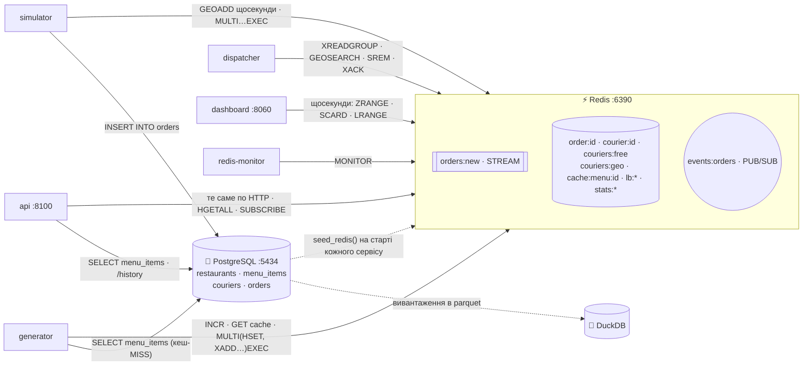
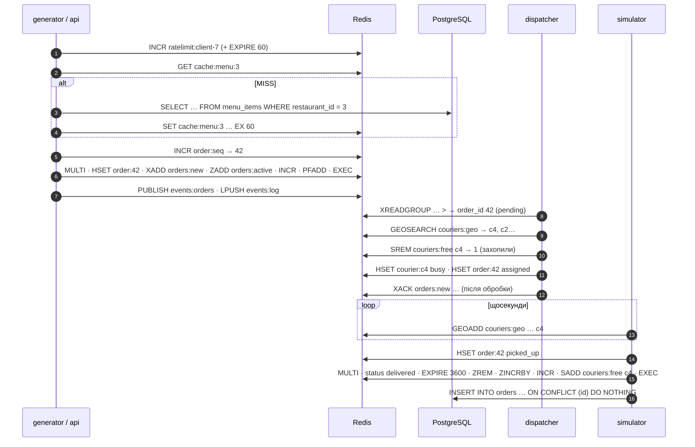

# Архітектура «Смачно + Таксі»

Ця сторінка — карта проєкту: **які процеси є, де лежать дані, хто їх змінює і чому саме так**.
Інтерактивна версія з анімаціями, пісочницею Redis і покроковим замовленням —
[`module_3/bonus/Бази даних — загальна картина.html`](../../bonus/Бази%20даних%20—%20загальна%20картина.html)
(завантаж і відкрий у браузері).

## 1. Три сховища — три ролі

| | Роль | Що лежить тут | Якщо зникне |
|---|---|---|---|
| 🐘 **PostgreSQL** | джерело правди | `restaurants`, `menu_items`, `couriers`, `orders` (лише доставлені) | бізнес зупинився → бекапи |
| ⚡ **Redis** | гаряча пам'ять + координація сервісів | черга, стан кур'єрів і активних замовлень, кеш, лічильники, рейтинги, події | активні доставки відновлювати; довідники й історія цілі |
| 🦆 **DuckDB** (поза проєктом) | аналітика по історії | копія `orders` у parquet | нічого: перерахуємо |

Правило вибору: **не можна втратити** → PostgreSQL; **потрібно «зараз», швидко або кільком сервісам разом** → Redis; **питання до всієї історії** → DuckDB.

## 2. Процеси і зв'язки

Шість процесів з `docker-compose.yml` не викликають одне одного: вони знають лише назви ключів Redis (`app/config.py`).

## 3. Одне замовлення від кліку до PostgreSQL

Як побачити це наживо: `docker compose logs -f dispatcher simulator generator api`, `docker compose logs -f redis-monitor`, `docker compose logs -f postgres`. Розділ «Логи» в [README](README.md).

## 4. Сутності: де живе кожна

| Сутність | PostgreSQL (правда) | Redis | Хто змінює | Хто читає |
|---|---|---|---|---|
| Ресторан | `restaurants` | `HASH restaurant:<id>`, `GEO restaurants:geo`, `ZSET lb:restaurants:revenue` | `seed_redis()` (копія), `deliver()` (виторг) | диспетчер, API `/restaurants` |
| Страва | `menu_items` | `STRING cache:menu:<id>` (EX 60) | ціни — у PostgreSQL + `invalidate_menu()` | `get_menu()` |
| Кур'єр | `couriers` (довідник) | `HASH courier:<id>`, `GEO couriers:geo`, `SET couriers:free/all`, `ZSET lb:couriers:deliveries` | `try_assign()` (SREM), `tick()` (GEOADD), `deliver()` (SADD) | диспетчер, дашборд, API |
| Замовлення | `orders` — **лише доставлені** | `HASH order:<id>`, `STREAM orders:new`, `ZSET orders:active / orders:waiting`, `STRING order:seq` | `create_order()`, `try_assign()`, `tick()`, `deliver()` | усі |
| Клієнт | лише колонка `orders.customer` | `STRING ratelimit:<клієнт>`, `HLL stats:customers:unique` | `check_rate_limit()`, `create_order()` | rate limit, `/stats` |
| Подія | — | `PUB/SUB events:orders`, `LIST events:log` | `publish_event()` | `/events` (SSE), дашборд |

## 5. Функція → команди → ключі

| Файл · функція | Redis / SQL | Ключі / таблиці | Навіщо |
|---|---|---|---|
| `orders.check_rate_limit()` | `INCR`, `EXPIRE` | `ratelimit:<клієнт>` | ≤ 3 замовлень/хв |
| `menu.get_menu()` | `GET`, `SET … EX 60`, `INCR` · `SELECT` | `cache:menu:<id>` · `menu_items` | cache-aside |
| `menu.invalidate_menu()` | `DEL` | `cache:menu:<id>` | після зміни цін |
| `orders.create_order()` | `INCR`, `MULTI(HSET, XADD, ZADD, INCR, PFADD)EXEC` | `order:seq`, `order:<id>`, `orders:new`, `orders:active`, `stats:*` | замовлення разом або ніяк |
| `orders.publish_event()` | `PUBLISH`, `LPUSH`, `LTRIM` | `events:orders`, `events:log` | live-подія + стрічка |
| `seed.seed_redis()` | `SELECT` · `GEOADD`, `HSET`, `SADD`, `XGROUP CREATE` | `restaurants`, `couriers` → `restaurant:*`, `courier:*`, `*:geo`, `couriers:*`, `orders:new` | прогрів, ідемпотентно |
| `dispatcher.run()` | `XREADGROUP` (спершу `0`, потім `>`), `XACK` | `orders:new` | черга; pending після падіння |
| `dispatcher.try_assign()` | `HGETALL`, `GEOSEARCH`, `SREM`, `HSET` / `ZADD` | `order:<id>`, `couriers:geo`, `couriers:free`, `orders:waiting` | найближчий вільний кур'єр |
| `dispatcher.process_waiting()` | `ZRANGEBYSCORE`, `ZREM` | `orders:waiting` | повтор, коли настав час |
| `simulator.tick()` | `GEOPOS`, `GEOADD`, `HSET` | `couriers:geo`, `courier:<id>`, `order:<id>` | рух кур'єрів |
| `simulator.deliver()` | `MULTI(HSET, EXPIRE, ZREM, ZINCRBY, INCR, HSET, SADD)EXEC` | `order:<id>`, `orders:active`, `lb:*`, `stats:delivered`, `couriers:free` | завершення |
| `db.save_delivered_order()` | `INSERT … ON CONFLICT DO NOTHING` | `orders` | назавжди, повтор безпечний |

## 6. Чому так, а не інакше

- **Замовлення в PostgreSQL лише після доставки.** Поки доставка триває, статус змінюється кілька разів за хвилину, і його читають усі сервіси: це гарячі дані для Redis. У PostgreSQL іде підсумкова правда, одним `INSERT`.
- **Черга — Stream, а не LIST чи Pub/Sub.** Pub/Sub губить усе, коли диспетчер не слухає. LIST губить замовлення, з яким диспетчер упав. Stream тримає його в pending до `XACK` і ділить роботу між кількома диспетчерами.
- **`XACK` після обробки.** Інакше падіння між підтвердженням і обробкою загубить замовлення. Ціна — можлива повторна обробка, тому `try_assign()` пропускає вже призначені (at-least-once + ідемпотентність).
- **`SREM`, а не «перевірити, потім зайняти».** Між двома командами вклинюється інший диспетчер. `SREM` — перевірка й захоплення в одній атомарній команді.
- **id з `INCR order:seq`.** Ми не пишемо в PostgreSQL до завершення замовлення. `INCR` атомарний, тож однакових номерів не буде. AOF (`--appendonly yes`) зберігає лічильник після перезапуску.
- **Ціни — з меню, не від клієнта.** Усе, що стосується грошей, рахує сервер.
- **Кожна подія і в `PUBLISH`, і в `LIST`.** Pub/Sub — для тих, хто слухає зараз; стрічка з 30 подій — для тих, хто відкрив дашборд пізніше.
- **`seed_redis()` на старті кожного сервісу.** Redis може бути порожнім. Функція ідемпотентна, тож хто стартує першим, той і наповнює.
- **Шість процесів, а не один скрипт.** Падіння одного не зупиняє інших, диспетчерів можна запустити кілька, логи окремі.
- **Усі ключі в `config.py`.** У Redis немає схеми: одна описка — і два сервіси мовчки працюють з різними ключами.
